<!-- BANNER -->

  

<!-- APRESENTAÇÃO ANIMADA -->

  

 

## 👨‍💻 Sobre mim

Olá! Sou Augusto Torin, Desenvolvedor Web na **Peex Brasil** e estudante de **Engenharia de Software na FIAP**.

Na Peex Brasil, iniciei minha trajetória como estagiário e atualmente atuo como Desenvolvedor Web, tendo contato com sistemas corporativos e tecnologias como ASP Classic, HTML, CSS e JavaScript.

Fora do ambiente profissional, venho aprofundando meus conhecimentos em lógica de programação, desenvolvimento front-end e React, além de explorar tecnologias voltadas ao desenvolvimento back-end.

🎯 **Objetivo:** evoluir como desenvolvedor Full Stack, construir soluções eficientes e participar de projetos que gerem impacto real.

---

## 🛠️ Tecnologias e ferramentas

  

### 📚 Atualmente estudando

  

  
Estudando C# e aprofundando meus conhecimentos em desenvolvimento de software.

---

## 📊 GitHub Analytics

  

  

  

---

## 🐍 Minhas contribuições

  

---

## 🎓 Formação acadêmica

- **FIAP** — Engenharia de Software (em andamento).
- **SENAI** — Técnico em Plásticos (concluído).
- **SESI** — Ensino Médio (concluído).

---

## 📫 Vamos nos conectar?

  

  

   
  

